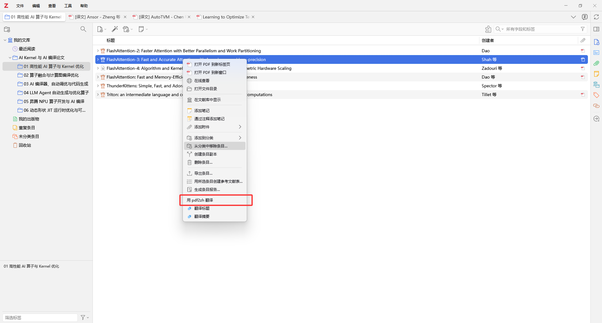
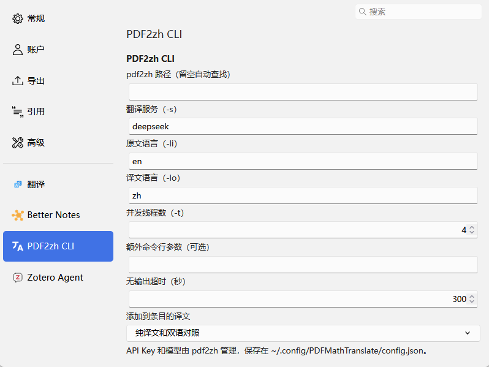

# PDF2zh CLI for Zotero

在 Zotero 里右键翻译 PDF。插件直接调用本机的 [`pdf2zh`](https://github.com/PDFMathTranslate/PDFMathTranslate) 命令，译文自动添加为条目附件，不需要常驻服务。

## 功能

- 右键条目或 PDF 附件，选择「用 pdf2zh 翻译」
- 可生成纯译文（`[译文] 原标题`）和双语对照（`[双语] 原标题`），也可以只生成其中一种
- 多选时排队，逐个翻译，进度窗口显示每个 PDF 的页数进度
- 翻译中可从右键菜单取消，整个进程树都会结束，不会添加任何附件
- 重新翻译成功后才把旧译文移到回收站，失败时旧译文不受影响
- 原 PDF 不会被改动：`pdf2zh` 处理的是临时副本，结束后自动清理

## 环境要求

- Zotero 10 或 11
- `pdf2zh`（PDFMathTranslate）1.x，已用 v1.9.11 测试

插件的端到端测试只在 Windows 上跑过。代码里有 macOS 和 Linux 的路径处理，但这两个平台没有验证。

## 安装

### 1. 安装 pdf2zh

推荐用 [uv](https://docs.astral.sh/uv/) 安装：

```shell
uv tool install --python 3.12 pdf2zh
```

插件按以下顺序查找可执行文件：

1. 插件设置里填写的路径
2. `PATH`
3. `~/.local/bin`（uv 的默认位置）

### 2. 配置翻译服务

API Key 和模型由 `pdf2zh` 管理，插件不保存这些信息。默认服务是 DeepSeek，在 `~/.config/PDFMathTranslate/config.json` 中配置：

```json
{
  "translators": [
    {
      "name": "deepseek",
      "envs": {
        "DEEPSEEK_API_KEY": "你的 API Key",
        "DEEPSEEK_MODEL": "deepseek-chat"
      }
    }
  ]
}
```

其他服务的配置方式见 [PDFMathTranslate 文档](https://github.com/PDFMathTranslate/PDFMathTranslate)。

### 3. 构建并安装插件

构建只需要 Python 标准库：

```shell
git clone https://github.com/Felix-bin/zotero-pdf2zh-cli.git
cd zotero-pdf2zh-cli
python build.py
```

然后在 Zotero 中打开「工具 → 插件」，点齿轮图标，选择「Install Add-on From File...」，安装 `dist/pdf2zh-cli-<版本号>.xpi`。

插件不会自动更新。更新时拉取新代码，重新构建并安装。

## 使用

选中一个或多个条目，右键选择「用 pdf2zh 翻译」。



| 选中的内容 | 翻译的文件 | 译文的位置 |
| --- | --- | --- |
| 普通条目 | 该条目的第一个 PDF（不含译文） | 该条目的附件 |
| 条目下的 PDF 附件 | 选中的 PDF | 同一条目的附件 |
| 独立 PDF | 选中的 PDF | 独立附件，放在相同的分类下 |

没有可翻译 PDF 的条目、笔记、已生成的译文和只读文库不会显示翻译菜单。

如果条目已有译文，插件会询问重新翻译还是跳过。重新翻译时会传入 `--ignore-cache`，不使用 `pdf2zh` 的缓存。

## 设置

设置位于 Zotero 设置的「PDF2zh CLI」页面。



| 设置项 | 默认值 | 说明 |
| --- | --- | --- |
| pdf2zh 路径 | 空 | 留空时自动查找 |
| 翻译服务（`-s`） | `deepseek` | 服务名称，需与 `pdf2zh` 的配置一致 |
| 原文语言（`-li`） | `en` | |
| 译文语言（`-lo`） | `zh` | |
| 并发线程数（`-t`） | `4` | |
| 额外命令行参数 | 空 | 原样传给 `pdf2zh`，按空格分隔，可用双引号包含空格，例如 `-p 1-5 --config "D:/my config.json"` |
| 无输出超时（秒） | `300` | 超过这个时间没有输出就终止，最小 `30` |
| 添加到条目的译文 | 纯译文和双语对照 | 也可以只选一种 |

## 常见问题

**提示「找不到 pdf2zh」**

Zotero 的 `PATH` 可能和终端不同。在插件设置里填写完整路径即可，可以用 `where pdf2zh`（Windows）或 `which pdf2zh`（macOS、Linux）查看。

**提示 API Key 无效、余额不足、拒绝访问或模型不存在**

`pdf2zh` 遇到这类错误时会一直挂起不退出，所以插件检测到错误日志（401、402、403、404）后会主动结束任务并显示原因。请检查 `config.json` 和服务商账户。

**提示「超过 N 秒没有输出」**

首次运行时 `pdf2zh` 可能要下载版面分析模型，网络慢时可以调大无输出超时。

**提示「本地没有这个 PDF」**

PDF 还没下载到本机。先在 Zotero 中打开或同步下载这个附件，再翻译。

## 已知限制

- 插件靠附件标题的 `[译文] `、`[双语] ` 前缀识别译文。手动改掉前缀后，这个附件会被当作普通 PDF，也不再被视为已有译文。
- 独立 PDF 不会检查已有译文，重复翻译会生成新的附件。
- 进度窗口、错误提示和对话框目前只有中文；菜单和设置页支持中文和英文。

## 开发

```text
bootstrap.js        插件生命周期
translator.js       菜单、队列、调用 pdf2zh、添加附件
preferences.xhtml   设置页
prefs.js            默认设置
locale/             菜单和设置页的多语言文本
build.py            打包为 dist/*.xpi
test/               端到端测试
```

端到端测试会在临时的 Zotero 配置和数据目录里运行已构建的 XPI，不会碰你自己的文库，也不会影响正在运行的 Zotero。

测试目前只支持 Windows，要求 Zotero 安装在 `C:\Program Files\Zotero`，并用 `pdf2zh` 所在 uv 环境的 Python 运行（它自带 `pymupdf`）：

```powershell
python build.py

# 完整测试：调用真实翻译服务，会消耗少量 API 额度
& "$env:APPDATA\uv\tools\pdf2zh\Scripts\python.exe" -I test/run_e2e.py

# 只测设置页、禁用和重新启用，不调用翻译服务
& "$env:APPDATA\uv\tools\pdf2zh\Scripts\python.exe" -I test/run_e2e.py lifecycle
```
